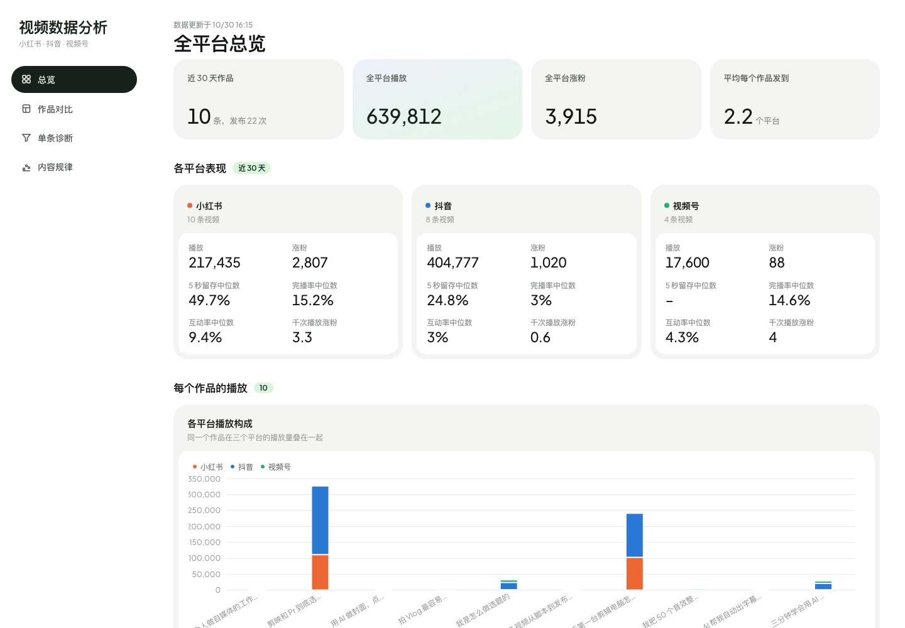
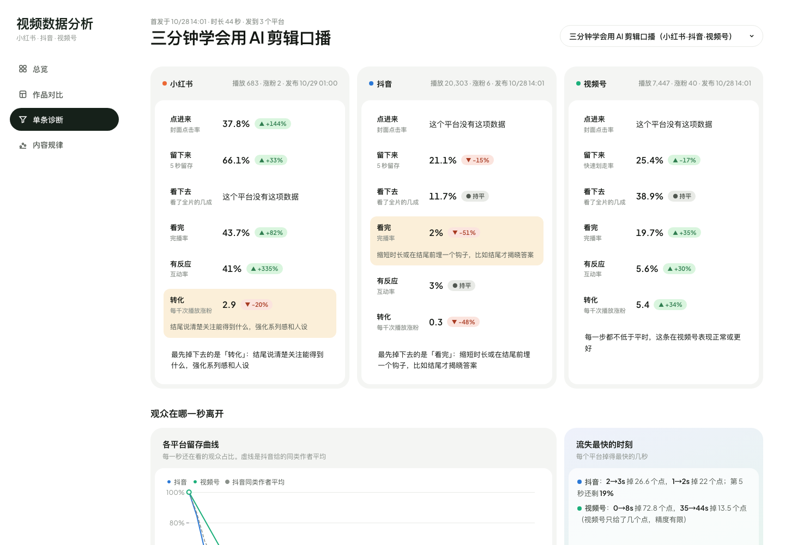

# 视频数据看板

自动抓取小红书、抖音和微信视频号创作者后台的数据，存进本地数据库，生成一个看板，回答这几个问题：

- 同一条视频发到三个平台，哪里表现最好？
- 观众在第几秒离开？
- 这条视频卡在哪一环：没人点、留不住、看不完，还是看完了不互动、不关注？

截图里的作品和数字都是虚构的示例数据。

## 它能做什么

- **三平台自动抓取**：用 [ego lite](https://lite.ego.app/) 浏览器打开你已经登录的创作者后台，读取后台页面本身加载的数据。不需要申请任何开放平台接口，也不需要把账号密码交给脚本。
- **一个作品，多次发布**：同一条视频发到多个平台会自动合成一个「作品」，可以放在一起比较。
- **和自己比**：每个指标都除以你在该平台的中位数。比如「+30%」表示比你平时高 30%，不同体量的账号也能直接看出好坏。
- **诊断漏斗**：按点进来、留下来、看下去、看完、有反应、转化这六步，标出最先掉队的那一环，并给出改进方向。
- **每秒留存曲线**：三个平台叠在一起看，抖音另外附带同类作者的平均水平做对照。
- **每天自动更新**：Mac 开机或开盖后自动运行，失败时弹通知；数据库每天备份到 iCloud。

## 快速开始

Mac 和 Windows 都能用。主要的命令差别是：Mac 上写 `python3`，Windows 上写 `py`。

| | Mac | Windows |
|---|---|---|
| 需要的软件 | [ego lite](https://lite.ego.app/)、python3（装过 Xcode 命令行工具就有） | [ego lite](https://lite.ego.app/)、[Python 3](https://www.python.org/downloads/)（安装时勾选 Add to PATH） |
| 先看示例效果 | `python3 preview.py` | `py preview.py` |
| 手动更新数据 | `python3 update.py` | `py update.py` |
| 每天自动更新 | launchd，开盖后自动补跑，失败弹通知 | 任务计划程序，错过的会补跑 |
| 自动备份 | 每天备份到 iCloud | 暂无，需手动复制 `data\videos.db` |

只想先看看效果的话，下载后运行 preview，再打开 http://localhost:8765 ，就能看到用示例数据画出的看板。

要接上自己的数据：

1. 安装 ego lite，完成首次引导。之后在终端（Windows 上用 PowerShell）里输入 `ego-browser`，应该能看到它的帮助信息。
2. 在 ego lite 里登录这三个后台：小红书创作服务平台、抖音创作者中心、视频号助手。
3. 在项目目录运行 update。它会依次抓三个平台，写进 `data/videos.db`，生成 `dashboard/data.js`。
4. 再运行 preview，看到的就是你自己的数据了。

不需要安装任何第三方 Python 包。每天自动运行的设置方法分 Mac 和 Windows 两种，都写在 [自动化流程](docs/automation.md) 里。

Windows 流程作者还没有在真机上完整测试过，遇到问题欢迎提 issue。

## 文件说明

| 文件 | 作用 |
|---|---|
| `fetch.mjs`、`fetch_douyin.mjs`、`fetch_channels.mjs` | 分别抓小红书、抖音、视频号，原始数据存到 `data/raw/` |
| `ingest.py` | 写进 SQLite，配对作品，计算相对表现，导出看板数据 |
| `update.py` | 一键更新：抓取、入库，可选上传到你自己的网站 |
| `preview.py` | 在本地打开看板 |
| `dashboard/index.html` | 看板页面，单文件，用 ECharts 画图 |
| `daily.sh`、`backup.sh`、`launchd.plist.template` | Mac 每天自动运行和 iCloud 备份 |
| `config.example.env` | 可选配置，比如上传地址，复制成 `config.env` 再改 |

## 延伸阅读

- [自动化流程](docs/automation.md)：每天自动跑、失败通知、iCloud 备份，以及怎么部署到自己的网站。
- [界面美化](docs/design.md)：这套看板的设计思路和配色、字体、卡片规范，也可以直接拿去给 AI 用作改界面的说明。

## 注意事项

- 这个项目通过模拟人工打开后台页面来读数据。各平台改版后，抓取脚本可能需要跟着调整。抓取频率保持每天一次就够了。
- 只读取你自己账号的数据，不发帖、不修改任何东西。
- `data/`、`config.env`、`.upload_key` 都在 `.gitignore` 里。如果你 fork 了这个仓库，不要把它们提交上去。
- 已知限制：小红书和抖音目前只抓列表的第一页（最近的作品）；视频号后台本身只给大约 6 个点的留存数据，所以它的曲线比较粗。

## License

MIT
